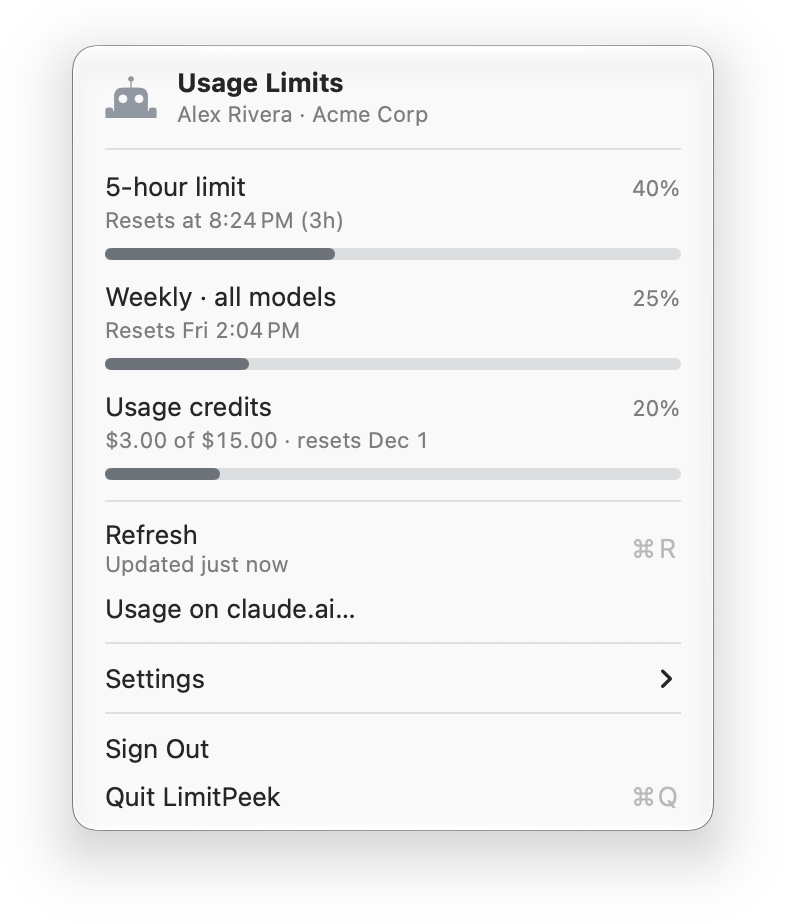
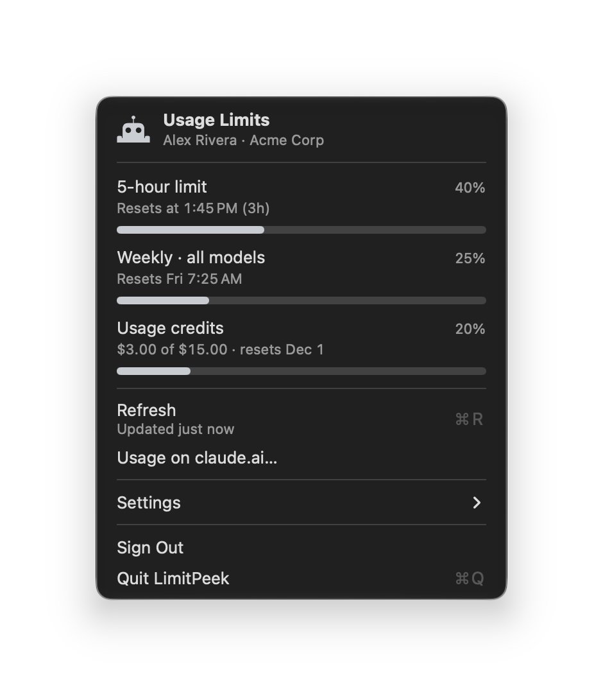

<div align="center">


# LimitPeek

Your Claude usage limits in the macOS menu bar.

[](https://github.com/nvmddev/limitpeek/actions/workflows/ci.yml)
[](https://github.com/nvmddev/limitpeek/releases/latest)
[](#install)
[](LICENSE)




</div>

> [!IMPORTANT]
> LimitPeek is not an official Anthropic app. Read the [disclaimer](#disclaimer) before you use it.

## Features

The menu bar item shows how much of your 5-hour limit you used. It turns amber at 80% and red at 95%.

<p align="center">
  
  
</p>

Click it to see all your limits:

- The 5-hour limit
- Weekly limits, also per model if your plan has them
- Usage credits, if your account has them

Each limit shows when it resets. In **Settings**, you can show only the bar or only the percentage. You can also start LimitPeek at login.

## Install

LimitPeek needs macOS 14 or later on a Mac with Apple silicon.

Install it with Homebrew:

```sh
brew install --cask nvmddev/tap/limitpeek
```

Or download the `.dmg` from the [latest release](https://github.com/nvmddev/limitpeek/releases/latest). Then move LimitPeek to your Applications folder.

## Sign in

1. Click the LimitPeek item in the menu bar.
2. Choose **Sign In with Claude…**. Your browser opens.
3. Sign in to Claude and allow access. Claude then shows a code.
4. Copy the code and paste it into the LimitPeek window.
5. Click **Continue**.

LimitPeek gets its own token. This does not sign you out of Claude Code.

## How it works

LimitPeek reads your usage from the same API that Claude Code uses. It checks every 2 minutes, or every 5 minutes in Low Power Mode. It stops while your Mac or its display sleeps. Opening the menu shows the latest reading without asking again; choose **Refresh** for a new one.

If the server sends a rate limit error, LimitPeek waits at least 5 minutes before it tries again, and then checks only every 5 minutes for the next 20 minutes.

## Privacy

- LimitPeek asks only for the `user:profile` scope. With it, LimitPeek can read your profile and usage. It cannot send messages to Claude.
- The token stays in your macOS Keychain. LimitPeek does not write it to a file or a log.
- LimitPeek connects only to `api.anthropic.com` and `platform.claude.com`.
- The app runs in the macOS App Sandbox. It collects no analytics.

Sign out before you uninstall LimitPeek. This deletes the token from the Keychain.

## Build from source

You need Xcode. There are no other dependencies.

```sh
./build.sh          # release build for Apple silicon, in build/LimitPeek.app
./build.sh --debug  # faster debug build
./build.sh --run    # build, then start the app
swift test          # run the tests
```

For code signing and notarization, see [docs/signing.md](docs/signing.md).

## Disclaimer

LimitPeek is not an official Anthropic product. Anthropic does not support or endorse it.

LimitPeek uses a private Anthropic API. When Anthropic changes this API, LimitPeek can stop working.

LimitPeek signs in with the OAuth client of Claude Code. Anthropic's [usage policy](https://code.claude.com/docs/en/legal-and-compliance#authentication-and-credential-use) does not allow third-party apps to offer a Claude login or to store Claude tokens. Anthropic can enforce this at any time and without notice. Use LimitPeek at your own risk.

## License

[MIT](LICENSE)
